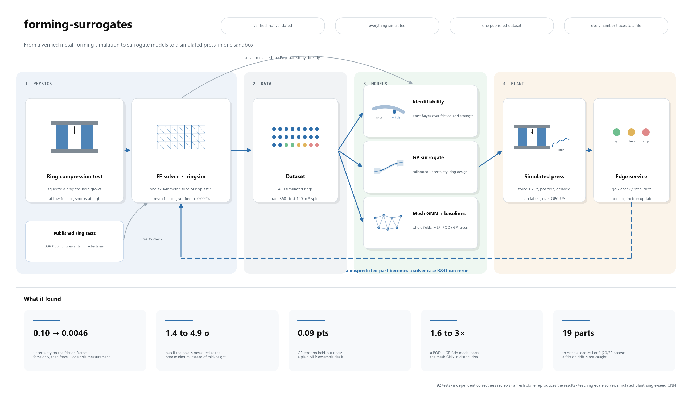
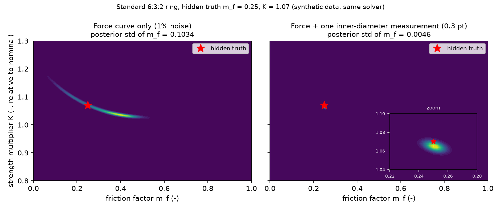

# forming-surrogates

**Can a forging press read the die friction from its force signal? Mostly not, and one inner-diameter measurement
can.** A small, verified finite-element solver of the ring compression test generates 460 simulated runs; a Bayesian
identifiability study, Gaussian-process and mesh-GNN surrogates, and a simulated press with an edge service are built
on them. Every number on this page sits in a results file under `results/`, written by the command recorded there.



1. **Force alone leaves friction uncertain; one inner-diameter measurement pins it down** (posterior std of the friction
   factor 0.10 against 0.0046). That is precision under the model's assumptions, not accuracy: measuring the diameter at
   the bore minimum instead of mid-height biases the answer by 1.4 to 4.9 standard deviations.
2. **First contact with experiment:** for published AA6068 ring tests (three lubricants, three reductions), one friction
   factor per lubricant is consistent across all three reductions (the values inferred at each reduction agree within 0.02 to 0.03), in the
   same order as the authors' own estimates. A consistency check against one lab, not a validation.
3. **Honest baselines win where they should:** a plain MLP ensemble matches the GP on scalar predictions, and a
   POD-plus-GP field model beats the mesh GNN in distribution. A simulated friction drift goes undetected by the
   press monitor.

> **Limits in four lines.** Simulated data except one published table. Teaching-scale solver: 2D axisymmetric,
> isothermal, no hardening, no remeshing (a quarter of all runs, and almost half of those with friction above 0.6, stop early). Not compared with
> industrial solvers, and no speed-up is claimed. Built by AI agents under the owner's direction (see
> [How this was built](#how-this-was-built)); details under [Limitations](#limitations).

## Results

### 1. The solver is verified (not validated)
Reproduced here with `python -m ringsim.verify --out results/verify` ([report](docs/reference/verify_report.md),
[data](results/verify/results.json)).

| Check | Outcome |
| --- | --- |
| V1-V2 exactness: frictionless homogeneous-field test against the exact solution (called a patch test in the report text), and scaling in material strength and die speed | PASS: force error 0.002%, inner-diameter error 0.005%; scaling exact to round-off |
| V3 inner-diameter change vs friction (30% reduction) | PASS: +19.5% at m=0 down to -22.2% at m=1 |
| V4 mesh convergence (m=0.3) | PASS: -4.42 / -4.44 / -4.44% for 6 / 8 / 12 layers |
| V5 sticking bound | INFO: regularised Tresca m=1 is 0.43 points from no-slip |
| V6 solver health | PASS: worst volume drift 0.74% |

Extra checks live in [results/solver/verify_extended](results/solver/verify_extended/results.json). They show that
**force is less mesh-converged than inner diameter** (nz=8 is still 0.83% above nz=12 at m=0.7), and that an
unstructured mesh moves the force by up to 9.6% for single cases at 30% reduction
([results/solver/s4_unstructured_vs_structured.json](results/solver/s4_unstructured_vs_structured.json)).
Details: [docs/explain/solver.md](docs/explain/solver.md).

### 2. Friction identifiability (the headline)


Standard 6:3:2 ring, true friction m_f = 0.25, material strength K 7% above nominal, 1% force noise. Posterior
standard deviation of m_f, from [results/identifiability/identifiability.json](results/identifiability/identifiability.json)
(the prior itself has std 0.289):

| Data | std of m_f (one noise draw) | mean over 100 draws |
| --- | --- | --- |
| force only | 0.103 | 0.105 |
| force + K known to 2% | 0.100 | 0.070 |
| force + one inner-diameter measurement (sigma 0.3 points) | 0.0046 | 0.0046 |

- Force and K are strongly confounded (posterior correlation -0.95), so force alone barely constrains friction.
- One inner-diameter measurement shrinks the uncertainty about 22 times (22.5 for this draw, 22.7 for the mean over draws).
- **Caveat:** knowing K to 2% helps much less than one might expect (0.105 to 0.070), because force is itself only
  weakly sensitive to friction.
- **Caveat:** the force at 30% reduction stops rising with friction near m_f = 0.43 (it peaks and falls slightly), and
  above about 0.55 it has jumps of both signs, up to about 8%, as nodes land on the die. Force-only uncertainty above
  about 0.45 is therefore unreliable (shaded in the figures).
- The inner-diameter curve also flattens at high friction, so the measurement is less informative there.
- **Precision is not accuracy.** The 0.0046 is the width of the posterior if the model is exactly right. Using the
  solver's bore-minimum inner diameter instead of the mid-plane one biases the m_f estimate by 1.4 posterior standard
  deviations at m_f = 0.25 and 4.9 at m_f = 0.1; an unmodelled 5% additive force offset biases the force-only estimate
  by 0.18 (true m_f 0.25) and 0.35 (true m_f 0.1) and leaves the force + inner-diameter estimate unchanged
  (`model_discrepancy` in the results file). That inner diameter does not depend on K follows from the model having no
  hardening or temperature.

- **Where to measure, and what an unknown rate sensitivity does**
  ([results/identifiability/where_to_measure.json](results/identifiability/where_to_measure.json), noise-free widths,
  standard ring, rate exponent m uniform on 0.05 to 0.30 when unknown): a single inner-diameter measurement at 30%
  reduction beats one at 10% (std of m_f 0.0063 against 0.0177 at m_f = 0.25, m unknown). Not knowing m costs little at
  low friction (0.0046 known, 0.0063 unknown at m_f = 0.25) and a lot at higher friction (0.0079 known, 0.0212 unknown
  at m_f = 0.5). The solver sweep behind this interpolates over m with a documented error
  (`interpolation_check` in the file), so treat these as typical widths, not guarantees.

Write-up: [docs/identifiability.md](docs/identifiability.md), plain-language walk-through:
[docs/explain/gp_identifiability.md](docs/explain/gp_identifiability.md).

### 3. First contact with experiment: published ring tests
Measured inner diameters from Pop, Neag and Sas-Boca, *Materials* 16(5), 2045 (2023), doi:10.3390/ma16052045
(open access, CC BY), Table 2: AA6068 aluminium, 6:3:2 ring (30:15:10 mm), room temperature, three lubrication
conditions at 20, 30 and 40% height reduction. The table is copied verbatim into
[data/external/pop2023_table2.yaml](data/external/pop2023_table2.yaml); for each row the solver's friction factor is
found by root finding on the measured inner-diameter change (rate exponent 0.05)
([results/validation/ring_test_pop2023.json](results/validation/ring_test_pop2023.json),
[figure](results/validation/figures/ring_test_pop2023.png)).

| Lubrication | m_f at 20 / 30 / 40% reduction | mean m_f | spread |
| --- | --- | --- | --- |
| dry | 0.348 / 0.362 / 0.366 | 0.359 | 0.018 |
| mineral oil | 0.273 / 0.282 / 0.252 | 0.269 | 0.030 |
| graphite in oil | 0.247 / 0.259 / 0.241 | 0.249 | 0.017 |

- **One friction factor per lubricant is consistent across the three reductions:** the values inferred at each reduction agree within 0.017 to 0.030, and the ordering (dry above
  mineral oil above graphite in oil) matches the authors' own Coulomb coefficients. The spread is larger than the
  diameters' reading resolution alone explains (about 0.003 to 0.007 in m_f), so the fit is good, not perfect.
- **Against the authors' numbers:** with the rough conversion m_f = sqrt(3) mu, the inferred factors are 1.2 times
  theirs for dry and about 1.85 times for the lubricated cases. Their values come from a different friction law
  (Coulomb) read off the Male-Cockcroft chart, so agreement within a factor of two is what one can expect.
- **What this is not:** a validation. The alloy's flow curve and rate sensitivity are unknown (a rate exponent of 0.02
  instead of 0.05 lowers the inferred factors by up to 0.026), it is one lab and one alloy, and the outer-diameter
  check is weak (predicted minus measured from -1.7 to +2.0 points, no consistent sign). Details:
  [docs/identifiability.md](docs/identifiability.md), section "First contact with experiment".

### 4. Gaussian-process surrogate
Fit on the training split only, targets taken from the curves at 10/20/30% reduction
([results/gp/gp_accuracy.json](results/gp/gp_accuracy.json)). Inner-diameter change, RMSE in percentage points:

| Model | test_random | test_ood_geometry | test_fine_mesh |
| --- | --- | --- | --- |
| GP (Matern 5/2, ARD) | 0.093 | 0.805 | 0.142 |
| scalar MLP ensemble (5 members) | 0.104 | 0.707 | 0.120 |
| cubic polynomial | 0.919 | 2.749 | 0.819 |
| gradient-boosted trees | 1.215 | 4.341 | 1.149 |

GP 95% interval coverage for inner diameter is 98%, 99% and 94% on the three splits: the intervals are conservative
(see the PIT histogram, [results/gp/figures/pit.png](results/gp/figures/pit.png)). The plant serves the standard deviation
scaled by a conformal factor (0.91, learned on a held-out part of train). For log force the raw coverage is weaker
(88%, 94%, 79%): the force GP is overconfident, especially on the fine mesh. **The MLP ensemble is as accurate as the
GP** (better on the two harder splits); the GP's case rests on its calibrated uncertainty and its use inside the
Bayesian design, not on beating a plain network.

- **K invariance** ([results/gp/invariance_K.json](results/gp/invariance_K.json)): re-solving cases at K = 0.6 and 1.6
  leaves the inner diameter unchanged to 2e-13 points, as the physics says.
- **Inverse friction by root finding** ([results/gp/inverse_friction.json](results/gp/inverse_friction.json)):
  6 to 10 solver calls per target. The GP mean gets within 0.004 of the solver's answer with no solver calls.
- **Best friction-sensing ring** ([results/design/design.json](results/design/design.json)): outer/inner diameter 2.35 and
  height/inner diameter 0.81, against 2.0 and 0.67 for the standard ring. The expected posterior std of m_f falls
  from 0.0169 to 0.0103 (factor 1.64 on the GP). A solver-only check on both rings (complete sweeps, no extrapolation) gives a factor of 1.70 over the common
  range. The gain comes mostly from high friction, where this solver is least reliable: for true friction up to 0.6
  the factor is only 1.24 (solver) and 1.20 (GP). The best ring sits near the edge of the training box, and the ranking
  looks at friction sensitivity only.

### 5. Mesh GNN surrogate: it works, but is not competitive on inner diameter
Encode-process-decode GNN predicting displacement, strain and force on the initial mesh, trained 30 epochs on CPU
(a compute-budget cap, not a tuned value), single seed. Variants: without and with a per-element
incompressibility (J) loss, with an added inner-diameter loss (`idloss`), and with extra fine-mesh training runs (`mixmesh`). Files: [results/gnn/](results/gnn/); explanation: [docs/explain/gnn.md](docs/explain/gnn.md).

| Inner-diameter RMSE (points) | test_random | test_ood_geometry | test_fine_mesh |
| --- | --- | --- | --- |
| scalar MLP ensemble ([n5](results/gnn/n5_mlp_baseline_full.json)) | 0.10 | 0.71 | 0.12 |
| GNN base ([eval](results/gnn/eval_base_full/metrics.json)) | 1.20 | 3.32 | 5.43 |
| GNN with J loss ([eval](results/gnn/eval_jloss_full/metrics.json)) | 1.26 | 2.79 | 5.38 |
| GNN with inner-diameter loss ([eval](results/gnn/eval_idloss_full/metrics.json)) | 1.52 | 3.91 | 5.74 |
| GNN with extra fine-mesh training runs ([eval](results/gnn/eval_mixmesh_full/metrics.json)) | 1.16 | 2.96 | 3.15 |

- On inner diameter the GNN is about ten times worse than the scalar models in distribution. Its value is that it
  predicts whole displacement and strain fields, which the scalar models cannot.
- Adding an inner-diameter loss did **not** close the gap (it was slightly worse). The **fine-mesh failure is mostly a
  mesh-density shift**: training on 60 extra runs at the finer density (some of them held out for validation during training) cut the fine-mesh field error by 60 to 75% and the
  force error from 3.8% to 1.1% (for the J-loss model; 4.5% for the base model), but the inner-diameter error is still 3.15 points and something besides density remains
  (untested). The extra runs share no case with any test split ([leakage check](results/gnn/mixmesh_leakage_check.json)).
- A **field baseline with no message passing** (POD + GP on a fixed grid, [results](results/gnn/pod_field_baseline_full.json))
  beats the GNN (J-loss variant) by 1.6 to 3 times on in-distribution field error (3 times for displacement dr, 1.6 to 1.7 times for dz and strain), so the GNN's value for fields is **not shown in
  distribution**; it wins only on out-of-range geometry (displacement error 0.131 against 0.214). Part of the fine-mesh
  gap is structural, because that baseline works on a mesh-independent grid. Single seed: the spread between variants is
  not measured.
- The J loss gives a mild improvement on most metrics, not a proven effect; see [n4_base_vs_jloss_full.json](results/gnn/n4_base_vs_jloss_full.json).
- Inference takes 11 to 19 ms per stroke position depending on the variant (timed on a shared laptop), against 63.5 s for a solver run. Those are different units of
  work, so no speed-up is claimed.

### 6. Simulated press: edge service, drift monitoring, repro bundles
`python -m plant.demo` replays 84 held-out solver runs as 600 parts per scenario through an OPC-UA server and an
edge service that predicts with the GP. Force drift starts at part 300. Results:
[drift](results/plant/drift/metrics.json), [nominal](results/plant/nominal/metrics.json),
[by split](results/plant/by_split.json). Guide: [docs/runbook.md](docs/runbook.md), explanation:
[docs/explain/plant.md](docs/explain/plant.md).

| Measure | Result |
| --- | --- |
| Drift detection (load-cell zero) | first alert at part 319, a delay of 19 parts; 0 false alarms before the drift |
| Predictions within 1.0 point of the gauge, before drift | 52 of 60 |
| same, after drift | 13 of 58 |
| same, nominal run (no drift) | 98 of 118 |

- Verdicts are go / check / stop. In the nominal run 208 of 600 parts get `check`: the GP is honestly unsure on
  out-of-range geometry, and a `go` needs the whole interval inside the spec band.
- **20 seeds, three drift types** ([results/plant/experiments.json](results/plant/experiments.json), 160 runs, nominal
  controls included): a zero-offset drift is detected in 20 of 20 runs (median delay 19 parts) by the monitored load-cell
  zero reading; a gain drift is found in 20 of 20 runs only by a second feature (median delay 39); a **friction drift is
  not detected by any drift monitor** (the friction estimate tracks it, but nothing watches that; the informational
  peak-force feature alerts in all 20 drift runs but also in all 20 nominal runs, so it carries no information). The two drift features raised
  no false alarm in 20 nominal runs. Re-zeroing after an offset alert lifts the after-drift acceptance from 0.33 to 0.81
  (paired difference +0.48, 95% interval 0.44 to 0.52), which is partly by construction: without re-zeroing the service
  carries the offset into its predictions.
- **The friction estimator treats the surrogate's error as shared within a lot** (the same ring and rate for every
  label), not as fresh noise per label. Before that fix it was overconfident on out-of-range geometry
  ([review/correctness.md](review/correctness.md), finding 4). Its friction error fell (mean absolute error 0.028, against 0.052 in the results before the fix, commit 0c66632), mostly on
  in-distribution lots, but acceptance on the two out-of-range lots fell from 19 of 20 to 15 of 20: on those lots the old
  estimator had absorbed the surrogate's bias into a too-low friction value that happened to help the prediction. Passing the learned offset to the prediction would need an
  interface change; it is designed, not built.
- When a part is mispredicted, a repro bundle holds the signal window, model version and a `ringsim` case that
  R&D can rerun. In the bundle checked ([part 494](results/plant/drift/bundles/part_00494/rerun.json)) the drifted
  force signal gave a wrong inferred reduction, so the fault lay in the input, not in the surrogate.
- The strokes are published in bursts and the 6 s cycle is compressed 24 times; this is not a real-time claim.
  Latency from stroke end to verdict was p50 9.6 ms and p99 299 ms in the drift run, measured on a loaded
  laptop against an assumed 6 s cycle (no part missed it); it varies with machine load.

## Use it, extend it, learn from it
This is a sandbox: small enough to run on a laptop, complete enough to touch every step from physics to a machine.

**Use it**
- **Play with the physics:** change the ring proportions, friction or rate sensitivity in `ringsim` and watch the hole
  grow or shrink; the solver takes about a minute per ring.
- **Generate your own data:** `ringsim.campaign` produces a labelled dataset (curves and full mesh fields) for any
  surrogate or inverse-problem experiment you want to try.
- **Use the trained models:** `surrogates.gp_bo.api.load("artifacts/gp")` gives a surrogate and a friction estimator
  behind a small interface; the GNN checkpoints in `artifacts/gnn/` load without retraining.
- **Replay a press:** `plant.demo` runs a shift of 600 parts with your choice of drift scenario, and the Streamlit
  dashboard replays it part by part.

**Extend it** (each is a contained project; where to start is in brackets)
- **Physics:** strain hardening, a Coulomb friction law, thermal coupling, or remeshing so high-friction runs stop
  folding over (`ringsim/solver.py`). Other processes, such as plain upsetting or closed-die forging, reuse the same
  machinery.
- **Data and calibration:** feed more published or measured ring tests through the validation route
  (`surrogates/gp_bo/validation_pop2023.py`) and turn the consistency check into a real calibration.
- **Active learning:** use the GP's uncertainty to choose the next solver runs instead of a fixed Latin hypercube.
- **Models:** multi-fidelity GPs (coarse and fine mesh), neural operators, GNN ensembles with several seeds, or a
  geometry family that a fixed grid cannot represent, which is where a mesh GNN should start to earn its keep.
- **Inference:** treat sensor gain and offset as unknowns, pool lots in a hierarchical model, and monitor the friction
  posterior itself so a friction drift is no longer missed.
- **Plant:** pass the per-lot surrogate offset into the predictions, publish strokes in real time, or add MQTT next to
  OPC-UA (`serving/edge/`, `plant/`).

**Learn from it** (plain-language guides in `docs/explain/`)
- Computational mechanics: the weak form of viscoplastic flow, Newton's method, friction laws, verification versus
  validation, and why force converges worse than shape.
- Bayesian inference: identifiability as a posterior shape, model discrepancy, and where to measure.
- Surrogate modelling: Gaussian processes, calibration, honest baselines, out-of-distribution tests and leakage checks.
- Geometric deep learning: meshes as graphs, physics-informed losses, and mesh-density shift.
- ML next to a machine: signal interfaces, OPC-UA, edge inference, drift detection, delayed labels and reproducible
  failure cases.

## From sandbox to industrial grade
Every component here is a stand-in. This is how each would be replaced for a real production line; none of it is
built in this repository.

| Sandbox component | Industrial replacement | What changes |
| --- | --- | --- |
| `ringsim`: 2D axisymmetric, isothermal, no hardening, no remeshing | A validated 3D thermo-mechanical forming solver with remeshing, temperature- and rate-dependent flow curves and calibrated contact | Results are validated against instrumented plant trials, not only verified |
| Assumed material and friction ranges | Flow curves from compression or torsion tests; friction calibrated per lubricant, temperature and die surface | The inputs become measured, with their own uncertainty |
| A campaign on one laptop | Batch simulation on HPC or cloud (Slurm or Kubernetes jobs), design of experiments, data versioning (for example DVC or lakeFS) | Every run is traceable to its solver version, inputs and mesh |
| GP on five scalar inputs | Surrogates on real part and process parameters, multi-fidelity, retrained as new simulations and plant data arrive; tracked in a model registry (for example MLflow) with model cards | Uncertainty is checked on real parts, and model versions go through approval |
| Simulated press replaying solver runs | The real press: PLC, load cell, position encoder, die thermocouples | Real noise, real drift, sensor faults and calibration schedules |
| OPC-UA on localhost with security off | OPC-UA on the PLC or an edge gateway with certificates and encryption, clock synchronisation (PTP or NTP), agreed sampling rates | Network and security engineering, with the signal interface agreed with the machine builder |
| Edge service as a Python process | A containerised service on industrial edge hardware with a watchdog, offline buffering and a safe default (`check`) whenever the model is unavailable | Latency is measured on the target hardware against the real cycle time |
| Simulated lab labels | Real metrology (gauges, CMM, vision) linked through the MES or LIMS by part ID | Labels arrive with their own delay, errors and gaps |
| PSI and KS drift tests, Streamlit dashboard | A monitoring stack (for example Prometheus and Grafana) with alert routing, plus operator screens in the HMI or MES | Alerts reach a person who is accountable for acting on them |
| Repro bundles in a folder | A ticket to R&D carrying the signal window, model version and a solver case that runs on the HPC cluster | The feedback loop becomes a tracked engineering process |
| Tests and reviews | CI/CD, a written validation protocol, change control and the plant's quality system | Model changes are released like any other process change, with sign-off |

What carries over unchanged are the ideas: the interface between model and machine, uncertainty-aware verdicts,
monitoring with delayed labels, and every number traceable to the run that produced it.

## How this was built
- **Plan first.** The scope, the work split and the rules were written before any code: frozen data and model
  interfaces, one owner per folder, "no number without a results file", and review gates.
- **AI agents wrote the code.** A lead agent coordinated four builder agents (solver, GP, GNN, plant), each on its own
  git branch, and independent reviewer agents audited each branch and the final state. Three reviews are published:
  the science ([review/expert.md](review/expert.md)) and two independent correctness checks
  ([review/correctness.md](review/correctness.md), [review/correctness_2.md](review/correctness_2.md)).
- **The human owner directed it:** approved each gate, decided which review findings to act on and in what order, and
  asked for the extra rounds (the expert review, its ten improvements, the correctness review).
- **Understanding it is the owner's job:** each area has a plain-language explanation in `docs/explain/` (solver, GP and
  identifiability, GNN, plant) written to be explained without reading the code.

## Limitations
### What this does not show
- **Almost no real data.** Apart from one published ring-test table (section 3), everything is simulated. The "machine", its sensors, its drift and its lab labels are generated from
  the same solver that trained the surrogates, so the plant results test the software chain, not the physics.
- **The identifiability result is a method demonstration under stated assumptions** (no hardening, no temperature,
  a known sensor model, the solver as truth). Its precision (how narrow the posterior is) is not accuracy: unmodelled
  bias in the force or inner-diameter measurement can move the answer by more than the quoted uncertainty. That
  inner diameter does not depend on material strength follows from the model's own formulation and is textbook
  knowledge for ring tests, not a discovery.
- **The solver is verified, not validated.** Its force is less mesh-converged than its inner diameter, and almost half of
  the runs with friction above 0.6 stop early, so conclusions in that corner rest on little data.
- **The GNN is not competitive** with the scalar models on inner diameter. Its only advantage is predicting whole fields.
- **Drift detection is easy by construction:** the drift is injected into the channel being monitored.

### Other limitations
- 105 of the 460 runs (23%) stopped early because mesh elements folded over (no remeshing); they are kept and flagged,
  and they sit mostly at high friction, where the surrogates have the least data (see [results/solver/censoring.json](results/solver/censoring.json)).
- Force is more sensitive to mesh and contact details than inner diameter (see section 1), so force-based
  conclusions are weaker than inner-diameter ones.
- The friction-estimation story uses the solver as truth (an "inverse crime"); a real sensor has gain and offset
  errors on top. The identifiability study uses a sweep of 26 solver runs, not the dataset.
- GP fits are deterministic for one thread count, platform and package set (4 threads, fixed seed, recorded in
  `artifacts/gp/meta.json`) but not across them: a refit with a different thread count moves RMSE and length scales slightly. Conclusions are
  unchanged; a rerun elsewhere will differ in the last digits.
  With the same settings the fit does reproduce: a fresh clone with a new virtual environment regenerated the GP
  artifacts byte for byte and every downstream metric exactly ([results/reproduction/clean_clone_check.json](results/reproduction/clean_clone_check.json)),
  at the time of that check; plant, design and GNN files regenerated afterwards (after the estimator fix and the later
  analyses) were not part of it.
- The GNN was trained once for 30 epochs; differences of a few percent between variants are not distinguishable from noise.
- Apart from the one published ring-test table in section 3, nothing here is compared with experiments, and `ringsim` has no temperature, remeshing or 3D effects.

## Designed, not built
- A friction prior informed by force (the edge service learns friction from measured inner diameters only).
- Passing the per-lot surrogate offset that the friction estimator learns into the edge service's predictions
  (needs a change to the model interface).
- Not attempted: ONNX export of the GNN, mixed precision, multi-objective design, live active learning.

## Run it
```bash
python -m venv .venv && source .venv/bin/activate        # Windows: .venv\Scripts\activate
pip install -r requirements.txt -r requirements-ml.txt
python -m pytest -q                                      # fast tests (data/smoke is in git)
python -m ringsim.verify --out results/verify            # about 3 minutes
python -m ringsim.campaign --out ~/forming-data/full --n-train 400 --n-ood 40 --n-fine 20   # resumable, about 30 minutes on 8 workers
python -m surrogates.gp_bo.run --data full --out results/gp
python -m surrogates.gp_bo.identifiability --out results/identifiability
python -m plant.demo --scenario drift --parts 600 --model surrogates.gp_bo.api:load --artifact artifacts/gp --data full --out results/plant/drift
streamlit run dashboard/app.py -- --results results/plant/drift
```
Set `FS_DATA_ROOT` to move the full dataset (default `~/forming-data`). GNN training is a separate multi-hour job:
see [docs/explain/gnn.md](docs/explain/gnn.md). The four trained GNN checkpoints (`best.pt`, about 1.5 MB each) are committed under `artifacts/gnn/`, so the GNN
evaluation can be regenerated with `python -m surrogates.gnn.evaluate --run artifacts/gnn/<name> --data full --out ...`
without retraining; only retraining is the multi-hour job. The dataset card is written next to the data.

## Layout
| Path | What |
| --- | --- |
| `ringsim/` | finite-element ring-compression solver and verification ([docs](docs/ringsim.md)) |
| `common/`, `serving/` | dataset loader and the model interface between the GP and the plant |
| `surrogates/gp_bo/`, `surrogates/gnn/`, `surrogates/baselines/` | GP, identifiability and design; GNN; scalar baselines |
| `plant/`, `serving/edge/`, `dashboard/` | press simulator, OPC-UA server, edge service, dashboard |
| `data/smoke/` | 13 sample runs used for development and tests |
| `results/` | every reported number, with the command that produced it |
| `docs/explain/` | plain-language explanations of each area |
| `review/` | three independent reviews: science and correctness |
| `tools/` | fresh-clone reproduction check, overview-diagram script |
