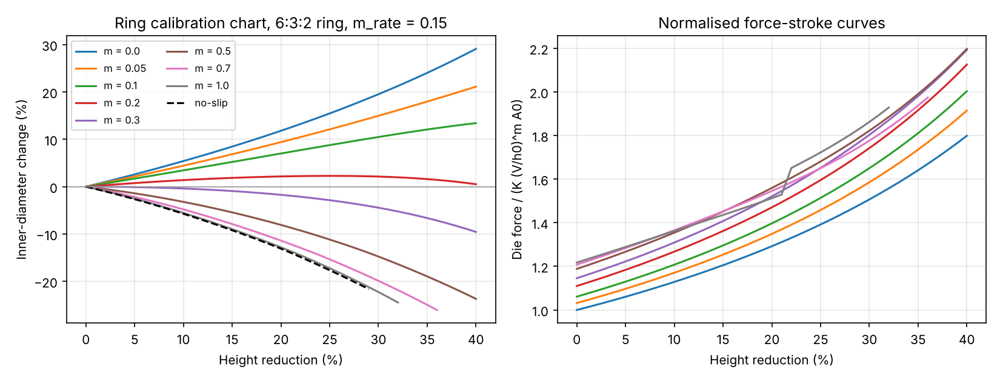

# Ring solver verification

| Check | Result | Details |
| --- | --- | --- |
| V1 Patch test: frictionless ring vs exact homogeneous solution (exact solution lies in the FE space) | PASS | at 40% reduction: force error 0.002%, inner-diameter error 0.005%, strain error 0.001%, volume drift 0.0022% |
| V2 Scaling in K and die speed implemented and checked | PASS | inner-diameter change differs by 6.8e-14 (K x10) and 0.0e+00 (V x10) percentage points; force ratio 10.000000 (expected 10) and 1.412538 (expected 10^m = 1.412538) |
| V3 Friction trend of the inner diameter (30% reduction) | PASS | m=0.0: +19.5%; m=0.05: +15.0%; m=0.1: +10.5%; m=0.2: +2.1%; m=0.3: -4.4%; m=0.5: -14.8%; m=0.7: -19.9%; m=1.0: -22.2% |
| V4 Mesh convergence (m=0.3, 30% reduction) | PASS | inner-diameter change -4.42% (nz=6), -4.44% (nz=8), -4.44% (nz=12) |
| V5 Sticking bound: Tresca m=1 vs no-slip | INFO | at 29% reduction: Tresca m=1 -21.19%, no-slip -21.62% (difference +0.43 points; regularised Tresca always allows some slip) |
| V6 Solver health on all runs | PASS | 15 runs, worst volume drift 0.74%, max Newton iterations 25, solves not reaching the 1e-8 tolerance 0 (worst relative update 1.0e-08), stopped early by fold-over: fric_0.7, fric_1.0, noslip |

