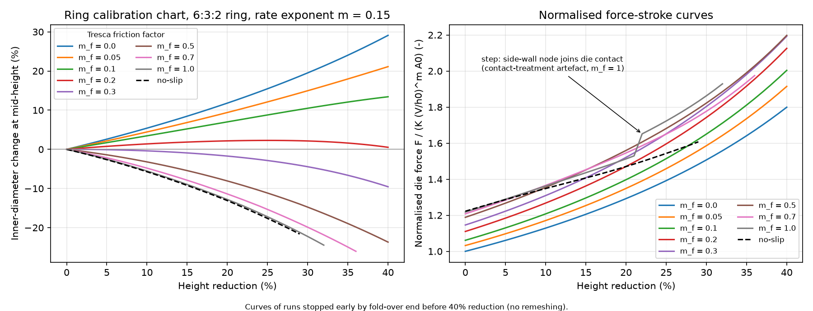

# Ring solver verification

| Check | Result | Details |
| --- | --- | --- |
| V1 Patch test: frictionless ring vs exact homogeneous solution (exact solution lies in the FE space) | PASS | at 40% reduction: force error 0.002%, inner-diameter error 0.005%, strain error 0.001%, volume drift 0.0022% |
| V2 Scaling in K and die speed implemented and checked | PASS | inner-diameter change differs by 1.4e-13 (K x10) and 2.9e-13 (V x10) percentage points; force ratio 10.000000 (expected 10) and 1.412538 (expected 10^m = 1.412538) |
| V3 Friction trend of the inner diameter (30% reduction) | PASS | m=0.0: +19.5%; m=0.05: +15.0%; m=0.1: +10.5%; m=0.2: +2.1%; m=0.3: -4.4%; m=0.5: -14.8%; m=0.7: -19.9%; m=1.0: -22.2% |
| V4 Mesh convergence (m=0.3, 30% reduction) | PASS | inner-diameter change -4.42% (nz=6), -4.44% (nz=8), -4.44% (nz=12) |
| V5 Sticking bound: Tresca m=1 vs no-slip | INFO | at 29% reduction: Tresca m=1 -21.19%, no-slip -21.62% (difference +0.43 points; regularised Tresca always allows some slip) |
| V6 Solver health on all runs | PASS | 15 runs, worst volume drift 0.74%, max Newton iterations 25, solves not reaching the 1e-8 tolerance 0 (worst relative update 1.0e-08), stopped early by fold-over: fric_0.7, fric_1.0, noslip |
| V1-label What V1 and V1b test (relabelled: frictionless homogeneous-field test) | INFO | V1 is not a patch test in the strict finite-element sense and not evidence about friction or contact. With zero friction the exact solution is a homogeneous field that lies in the P2/P1 space, so V1 only shows that the discretisation reproduces an exact homogeneous solution, and that assembly, the power-balance force and the time loop are consistent for it. It would pass with a wrong friction law or wrong contact handling. The friction physics is covered only by V3 (trend), V4/V4b (convergence) and V5/V5b (sticking bound). |
| V1b Patch test on unstructured meshes (3 random Delaunay meshes, 40% reduction) | PASS | worst over seeds: force error 0.002%, inner-diameter error 0.005%, strain error 0.001%, volume drift 0.0022% |
| V4b Mesh convergence of the inner diameter (m=0.7, 25% reduction) | PASS | inner-diameter change -15.39% (nz=6), -15.34% (nz=8), -15.39% (nz=12); distance to nz=12: 0.00 points (nz=6), 0.04 points (nz=8), NOT monotone (the nz=6 mesh agrees with nz=12 at least as well as nz=8) |
| V4b-F Mesh sensitivity of the normalised force (m=0.7, 25% reduction), not gating | INFO | normalised force 1.6599 / 1.6505 / 1.6369 for nz=6/8/12; nz=8 differs from nz=12 by 0.83%, nz=6 by 1.40% |
| V5b Friction-smoothing sensitivity: Tresca m=1 with delta_rel 1e-2 vs 1e-3, vs no-slip | INFO | at 29% reduction: delta_rel=1e-2 -21.19%, delta_rel=1e-3 -21.55%, no-slip -21.62%; gap to no-slip +0.43 -> +0.07 points; Newton iterations max 25 -> 40; final reduction reached 32% -> 32% |
| V3b Rate-exponent sensitivity of the friction curve (30% reduction; m_f = 0.0, 0.05, 0.1, 0.2, 0.3, 0.5, 0.7, 1.0) | INFO | inner-diameter change (%): m_rate=0.05: +19.5, +14.9, +10.3, +1.5, -6.8, -20.2, -23.6, -24.4; m_rate=0.15: +19.5, +15.0, +10.5, +2.1, -4.4, -14.8, -19.9, -22.2; m_rate=0.3: +19.5, +15.0, +10.6, +2.7, -2.8, -10.9, -16.0, -20.1; largest shift vs m_rate=0.15: 5.40 points (m_rate=0.05), 3.89 points (m_rate=0.3); total span over m_f: 43.9 points (m_rate=0.05), 41.8 points (m_rate=0.15), 39.6 points (m_rate=0.3). K-independence is exact by construction (V2); dependence on the rate exponent is not. |
| V6b Solver health on the extended runs | PASS | 8 runs, worst volume drift 0.58%, max Newton iterations 40, solves not converged 0, stopped early by fold-over: stick_d0.01, stick_d0.001 |

